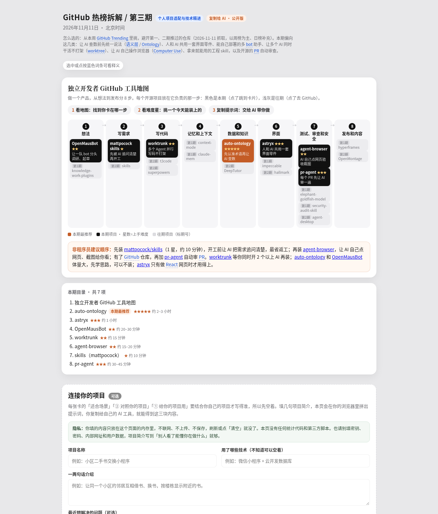

# GitHub 热榜拆解 · 个人项目适配与技术精进

`trending-to-project` · 源码公开（source-available），仅限非商业使用

每期从 GitHub Trending（GitHub 的热门榜）里挑 1 个最推荐的项目，加上 5–6 个值得看的项目，拆成一个打开就能看的网页，再对照到你自己的项目上。写给独立开发者，也写给不是程序员、想从 GitHub 上学点真本事的人。

> 许可：代码 PolyForm Noncommercial 1.0.0，内容 CC BY-NC-SA 4.0。只能用于个人学习、个人知识库和改进你自己的非商业项目，详见 [许可与使用范围](#许可与使用范围)。
>
> English summary is at the bottom.



---

## 这是什么

- 一个**单文件 HTML** 页面：双击用浏览器打开就能看，不用装任何东西，也不用联网。
- 一套**生成脚本**：把 `data/` 里的内容拼成网页，你可以照着格式自己做下一期。
- 一个**本地 skill** `project-fit`（给 AI 用的任务说明）：把本期项目对照到你自己的项目，生成专属建议。这一步只在你的电脑或你自己的 AI 工具里进行。

## 每期有什么

| 板块 | 内容 | 公开页面里有没有 |
| --- | --- | --- |
| 工具地图 | 做产品分 8 步，每个项目放在它负责的那一步 | 有 |
| 项目卡片 | 仓库地址、Star、近期新增、语言、Forks、许可证 | 有 |
| 它能做什么 / 最突出的点 / 适合谁用 | 用大白话说清楚 | 有 |
| 缺点与应对 | 每个项目 3 个缺点，各配一条应对办法 | 有 |
| 技术含金量、热门技术取舍 | 为什么值得学，几个同类工具怎么选 | 有 |
| 上榜原因、许可证与维护风险 | 为什么选它，用之前要注意什么 | 有 |
| 复制给 AI 就能用 | 上手难度（1–5 星）、大概耗时、需要先装什么、**通用版提示词** | 有 |
| 词条释义 | 选中或点按蓝色词，弹出「是什么 / 相当于 / 为什么需要 / 出处」 | 有 |
| **适合场景** | 这个项目在**你的**项目里具体能做什么 | **连接你的项目后生成** |
| **② 对照你的项目** | 接到你项目的哪一层、先做哪一步 | **连接你的项目后生成** |
| **① 给你的项目用（提示词）** | 一段专门给你项目的提示词 | **连接你的项目后生成** |

最后三块要结合你的项目才写得准，所以公开页面里只放一张占位卡片，告诉你怎么生成。

## 怎么看现成的 HTML

电脑上：

1. 打开 `examples/` 文件夹，双击 `issue-03.html`（第三期），浏览器会直接打开。
2. 页面上的蓝色词可以点，或者用鼠标选中任意技术词，会弹出释义。
3. 每张卡末尾有「复制」按钮，复制提示词，粘贴到 Claude Code、Codex、Cursor、ChatGPT 等任意 AI 工具里。

手机上请看下一节。也可以直接打开已经发布的网页：<https://huangyi0611.github.io/trending-to-project/>。

## 手机上怎么看

手机从分享菜单里打不开本地 HTML 文件，菜单里通常没有 Safari 或 Chrome。用下面几种办法。

**直接打开作者发布的网页（最快）**

- 首页：<https://huangyi0611.github.io/trending-to-project/>
- 第三期：<https://huangyi0611.github.io/trending-to-project/examples/issue-03.html>

用 Safari 点开即可，词条弹窗和复制按钮都能用。这个链接可以发到小红书或其他地方。

**给自己做一个同样能在手机上打开的网址**

你可以把本仓库复制到自己的 GitHub 账号，再用 GitHub Pages（GitHub 提供的免费网页托管）生成一个网址：

1. 打开仓库页面，点右上角 Fork，把仓库复制到你的账号下。仓库需要是公开的（免费账号才能用 GitHub Pages）。
2. 打开你账号下的这个仓库，进入 Settings（设置）→ Pages。
3. 在 Build and deployment（构建和部署）里，Source（来源）选 Deploy from a branch（从分支部署）；Branch（分支）选 `main`，文件夹选 `/ (root)`，点 Save（保存）。
4. 等一两分钟。Settings → Pages 页顶会出现网址：`https://<你的GitHub账号>.github.io/<仓库名>/`。某一期在：`https://<你的GitHub账号>.github.io/<仓库名>/examples/issue-03.html`（把 `03` 换成期号）。

作者这边已经按上面的方式打开了，所以你不用再设置，也能直接看上面的链接。

**这样放上网安不安全？**

公开版页面打开时不发任何网络请求，也不在手机或电脑上存数据。你把它发布到 GitHub Pages，不会泄露读者的项目信息。读者如果在页面上填写了「连接你的项目」，那些字只留在读者自己的浏览器内存里，刷新就消失，作者和 GitHub 都看不到。

有一类文件不能上网：用私人构建生成的、已经写进你自己项目内容的页面。这类文件默认在 `private/out/` 或 `output/`（都已被忽略，不会被提交）。不要把它们复制到 `examples/` 或仓库根目录，也不要发布到 GitHub Pages。私人版请在自己电脑上打开，或发到手机「文件」App 里预览，或在 AI 应用自带的浏览器里打开。

**其他办法**

- 把 HTML 存到 iPhone「文件」App 再点开：能看到排版，词条弹窗和复制按钮可能不能用。
- 在带内置浏览器的 AI 应用里打开这个文件或链接，交互功能通常可用。
- 在电脑上用 Chrome 或 Safari 打开，功能是完整的。

## 怎么自己生成一期

需要：电脑上装好 Python 3（3.9 或更新）。

```bash
# 1. 下载仓库
git clone https://github.com/huangyi0611/trending-to-project.git
cd trending-to-project

# 2. 安装唯一的依赖（用来解析 HTML）
pip install -r requirements.txt

# 3. 生成第三期，结果在 examples/issue-03.html
python3 build.py --issue 03
```

做新的一期：复制 `data/public/issue-03/` 改名为 `issue-04/`，改里面的卡片内容、`issue.json` 和 `toolmap.js`，再运行 `python3 build.py --issue 04`。构建时会同时根据各期的 `issue.json` 更新仓库根目录的 `index.html`（GitHub Pages 的首页），不用手改首页。也可以单独运行 `python3 build.py --index`。详细步骤见 [docs/USAGE.md](docs/USAGE.md)。

## 怎么用「交互生成」的那三块

公开页面里「适合场景」「② 对照你的项目」「① 给你的项目用」是占位卡片。想要针对你自己项目的内容，有两种做法，都由你自己发起：

**做法 A：在本页拼提示词（最简单）**

1. 打开 HTML，找到目录下方的「连接你的项目」。
2. 填项目名称、一两句介绍、用了哪些技术（可空）、最近想解决的问题（可空）。
3. 点「生成提示词」。每张卡末尾会出现「① 给你的项目用」，顶部还有一段「整期一次生成」。
4. 复制，粘贴给你自己的 AI 工具，它会写出「适合场景」「对照你的项目」和专属提示词。

拼提示词这一步只在你的浏览器内存里完成，不联网、不保存，刷新就清空。

**做法 B：在自己电脑上用 skill（适合每期都用）**

1. 复制 `my-project.example.yaml`，改名为 `my-project.yaml`，填上你的项目信息。这个文件被 `.gitignore` 忽略，不会被提交。
2. 在仓库目录里打开你的 AI 工具（Claude Code、Codex、Cursor 等），对它说：「按 `skills/project-fit/SKILL.md`，用我的 `my-project.yaml` 分析第 03 期。」
3. 也可以只拼提示词，自己复制给 AI：`python3 tools/make_prompt.py --issue 03`。
4. 结果建议存到 `output/issue-03.local.md`，这个位置同样被忽略，不会被提交。

想让自己看的那份页面直接带上这三块，可以用私人构建，见 [private/README.md](private/README.md)。

## 隐私与安全承诺

**本项目不收集、不上传、不读取、不窃取任何用户的项目信息。** 作者拿不到你填的任何内容，本仓库也没有任何服务器。下面是具体做法，每一条你都可以自己检查：

1. **页面零网络请求。** 生成的 HTML 把样式、脚本、释义全部写在一个文件里，不加载外部字体、图片、脚本，没有统计代码，没有第三方脚本。页面里的 GitHub 链接只有你点了才会打开。
2. **你填的项目简介只在浏览器内存里。** 「连接你的项目」的代码只把你填的字拼进页面上的文本框，不发请求，不写 localStorage、sessionStorage、cookie 或 IndexedDB。刷新或点「清空」就没了。
3. **个性化内容只在你自己那边生成。** 不管用做法 A 还是 B，真正分析你项目的都是你自己选的 AI 工具，在你自己的电脑或你自己的账号里运行。本仓库只提供模板。
4. **你的项目文件不会被提交。** `my-project.yaml`、`*.local.*`、`output/`、`private/`、`.env` 都写进了 `.gitignore`。
5. **仓库里没有任何密钥。** 没有 API key、token、密码，构建脚本也不读环境变量、不联网。
6. **提示词自带安全规矩。** 所有提示词都要求 AI：不把密钥、密码、验证码、用户数据写进代码、文档、提交记录或日志；只开新分支和 PR，合并到主分支和上线生产必须由你确认。
7. **代码少，看得完。** 页面里的交互代码在 `template/connect.js`，几十行，搜得到每一处读写。

**自己检查的方法：**

- **看网络请求**：用 Chrome 或 Edge 打开 HTML，按 F12 打开开发者工具，切到 Network（网络）面板，刷新页面，再填项目简介、点「生成提示词」。请求数应该一直是 0（只有页面文件自己）。
- **搜代码**：在仓库目录运行下面的命令，应该什么都搜不到：

  ```bash
  grep -nE "fetch\(|XMLHttpRequest|WebSocket|sendBeacon|navigator\.sendBeacon|localStorage|sessionStorage|document\.cookie|indexedDB|<script[^>]+src=|<link[^>]+href=\"http|@import" examples/*.html template/*
  ```

- **查有没有密钥**：

  ```bash
  grep -rnE "sk-[A-Za-z0-9]{20,}|ghp_[A-Za-z0-9]{30,}|github_pat_|AKIA[0-9A-Z]{16}|xox[baprs]-|-----BEGIN [A-Z ]*PRIVATE KEY" .
  ```

- **确认你的文件被忽略**：`git check-ignore -v my-project.yaml` 会显示是哪条规则忽略了它。

发现安全问题，请按 [SECURITY.md](SECURITY.md) 报告。

## 许可与使用范围

本项目**源码公开（source-available），仅限非商业使用**。它不属于 OSI 定义的开源软件。

| 部分 | 许可证 | 文件 |
| --- | --- | --- |
| 代码（`build.py`、`tools/`、`template/`） | PolyForm Noncommercial 1.0.0 | [LICENSE](LICENSE) |
| 内容（`data/`、释义、提示词、`examples/` 页面文字、`docs/` 和各说明文档） | CC BY-NC-SA 4.0 | [LICENSE-CONTENT.md](LICENSE-CONTENT.md) |

**可以：**

- 个人学习、研究；
- 搭你自己的个人知识库（比如存进 Obsidian、Notion 自用）；
- 改进你自己的非商业项目（个人作品、兴趣项目、学习项目）；
- 非商业地分享和改编，署名并保持同样的许可。

**不可以：**

- 任何商业使用；
- 转卖本仓库或它的内容，或者换个名字再卖；
- 做成付费课程、付费专栏、付费社群资料或其他付费内容；
- 做成 SaaS 或付费在线服务；
- 捆绑进商业产品，或者用来给客户做收费项目。

**商业授权**：请联系作者 `yihuangolivia@gmail.com`。

**关于 fork**：本仓库公开放在 GitHub 上。按 GitHub 服务条款，其他用户可以在 GitHub 上查看和 fork 公开仓库。这只是平台上的查看和 fork，不代表获得了商业使用权，fork 出来的副本同样受上面两个许可证约束。

## 版权与免责

完整内容见 [NOTICE.md](NOTICE.md)，要点如下：

- **版权**：著作权归作者所有，保留所有未明示授予的权利，包括商业授权。
- **专利**：作者没有为本项目申请或持有专利，也不声明任何专利，只主张著作权。
- **数据**：Star、Forks、语言、许可证来自 GitHub 公开信息，近期新增来自 GitHub Trending。每期页面底部写了读取日期（第三期是 2026-11-11），之后会变。
- **仅供学习参考**：释义、分析、难度和耗时是个人整理和估计，不构成专业、法律或安全建议。「出处 · 谁在用」一栏没有逐条核实。
- **后果自负**：照着提示词让 AI 改代码、装软件、跑命令，后果由使用者承担。
- **没有隶属关系**：与 GitHub 以及收录项目的作者没有隶属、合作或背书关系。「GitHub」只用来说明内容来源，不使用 GitHub 的 logo。
- **第三方项目**：每个收录项目以它自己仓库的许可证为准，页面只摘短句并附原仓库链接。
- **更正与下架**：联系 `yihuangolivia@gmail.com`，或开 issue。

## 目录结构

```
.
├── README.md                    # 本说明
├── LICENSE                      # 代码许可：PolyForm Noncommercial 1.0.0
├── LICENSE-CONTENT.md           # 内容许可：CC BY-NC-SA 4.0
├── NOTICE.md                    # 版权、专利说明、免责声明、更正与下架
├── SECURITY.md                  # 怎么报告安全问题
├── requirements.txt             # 唯一依赖：beautifulsoup4
├── build.py                     # 构建脚本：公开构建 / 私人构建 / 首页
├── my-project.example.yaml      # 虚构示例，复制成 my-project.yaml 再填
├── .gitignore
├── .nojekyll                    # 让 GitHub Pages 原样提供文件
├── index.html                   # 各期目录首页（由 build.py 根据各期 issue.json 生成，请勿手改）
├── data/public/
│   ├── glossary.json            # 释义词库（各期共用）
│   └── issue-03/
│       ├── issue.json           # 标题、首页摘要、每张卡的难度、耗时、前置条件、通用版提示词、方向标签
│       ├── toolmap.js           # 工具地图数据
│       └── parts/               # 每张卡的正文（HTML 片段）
├── template/                    # 页面外壳：样式、释义弹窗、复制按钮、「连接你的项目」、首页模板
├── skills/project-fit/
│   ├── SKILL.md                 # 本地 skill：Match trending GitHub repos to your own project, locally and privately.
│   └── prompt-template.md       # 提示词模板（网页和脚本共用）
├── tools/make_prompt.py         # 在本地用 my-project.yaml 拼提示词
├── private/README.md            # 私人数据目录的说明（目录里其他东西不会被提交）
├── examples/issue-03.html       # 第三期成品，直接打开看
└── docs/
    ├── USAGE.md                 # 分步使用说明
    └── screenshot-*.png         # 截图
```

## License

源码公开（source-available），仅限非商业使用。代码：[PolyForm Noncommercial 1.0.0](LICENSE)；内容：[CC BY-NC-SA 4.0](LICENSE-CONTENT.md)。发布前请把 `LICENSE`、`LICENSE-CONTENT.md`、`NOTICE.md` 里的 `假笑黄黄AI版（小红书）` 换成你的名字或昵称。

---

## English summary

**GitHub 热榜拆解 · 个人项目适配与技术精进** (`trending-to-project`) breaks down each issue's GitHub Trending picks (one top pick plus 5–6 projects) into a single, self-contained HTML page: what each project does, its highlights, drawbacks with workarounds, difficulty, prerequisites, a copy-to-AI prompt, a tool map, and a pop-up glossary. Written in plain Chinese for indie developers and non-programmers.

- **Read**: open `examples/issue-03.html` in any browser (no install, no network), or on a phone open https://huangyi0611.github.io/trending-to-project/ . To get your own phone-friendly URL, fork the repo and enable GitHub Pages (Settings → Pages → Deploy from a branch → `main` / `/ (root)`). Never publish a private/personalized build that already contains your own project content.
- **Build**: `pip install -r requirements.txt && python3 build.py --issue 03` (also refreshes `index.html` from `data/public/issue-*/issue.json`; or run `python3 build.py --index`).
- **Personalize** with the `project-fit` skill — *Match trending GitHub repos to your own project, locally and privately.* The "fit scenarios", "how it maps to your project" and "prompt for your project" sections are generated only after you provide your own project info, either in the page (assembled in memory, never sent anywhere) or locally via `skills/project-fit/SKILL.md` with your own AI tool and a git-ignored `my-project.yaml`.
- **Privacy**: zero network requests, no analytics, no third-party scripts, no storage writes, no secrets in the repo. Verify with your browser's Network panel and the grep commands above.
- **License**: source-available, **non-commercial use only** (this is not OSI open source). Code: PolyForm Noncommercial 1.0.0 (`LICENSE`). Content: CC BY-NC-SA 4.0 (`LICENSE-CONTENT.md`). Allowed: personal learning, personal knowledge bases, improving your own non-commercial projects. Not allowed: commercial use, resale, paid courses or content, SaaS, bundling into commercial products. For a commercial license, contact the author. Being able to view or fork this public repo on GitHub does not grant commercial rights.
- **Disclaimer**: data comes from public GitHub information as of the dates shown and may be outdated; analysis is for learning only and is not professional, legal or security advice; you are responsible for running any prompt or code; not affiliated with GitHub or any listed project; "GitHub" is used descriptively only; each listed project is governed by its own license. No patent is claimed. See `NOTICE.md`.
